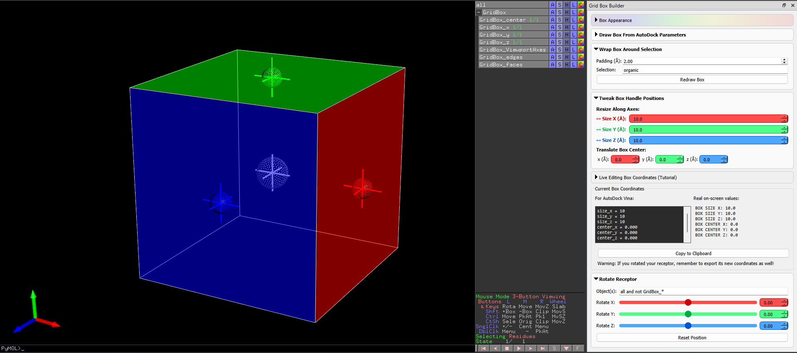

# Grid Box Builder
Defining the correct grid box parameters is one of the most crucial requirements to ensure the smooth running of a molecular docking simulation. This tool is designed to make the creation of such grid box intuitive, responsive, and flexible, in order to find the most optimized parameters possible.

This plugin is designed for PyMOL. A version compatible with ChimeraX is planned in the near future.

## Installation
From PyMOL’s menu, open the `Plugin > Plugin Manager` pop-up window. From the `Install New Plugin` tab, you can choose to install from a local file (choose file `GridBoxBuilder-PYMOL-Plugin.py`, which is self-contained and self-sufficient), or Install from Repository by adding this repository’s URL.

After installing, the plugin can be activated via PyMOL’s menu `Plugin > Grid Box Builder`.

## Customization
If you intend to modify the default behavior of this plugin (e.g. name of the created objects, initial position and size, axes colors...), all values of interest are defined at the very top of the file `GridBoxBuilder-PYMOL-Plugin.py` within the “User Settings” section.
